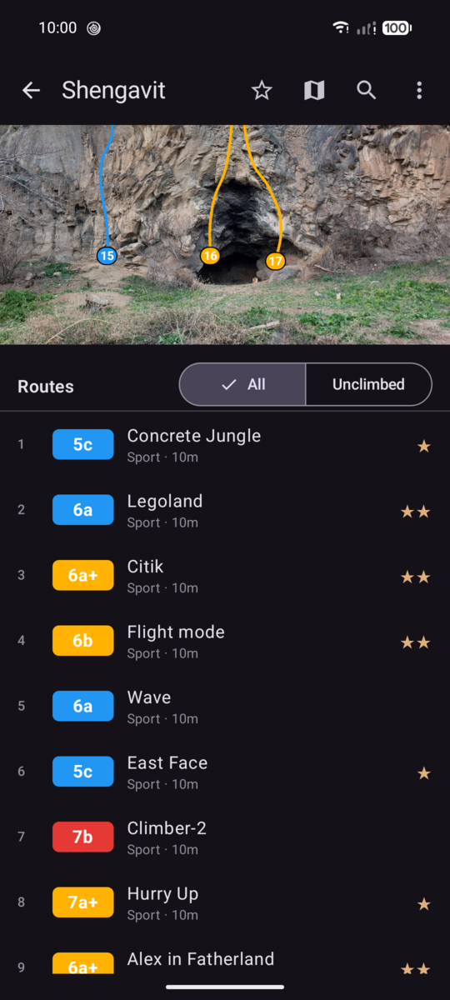
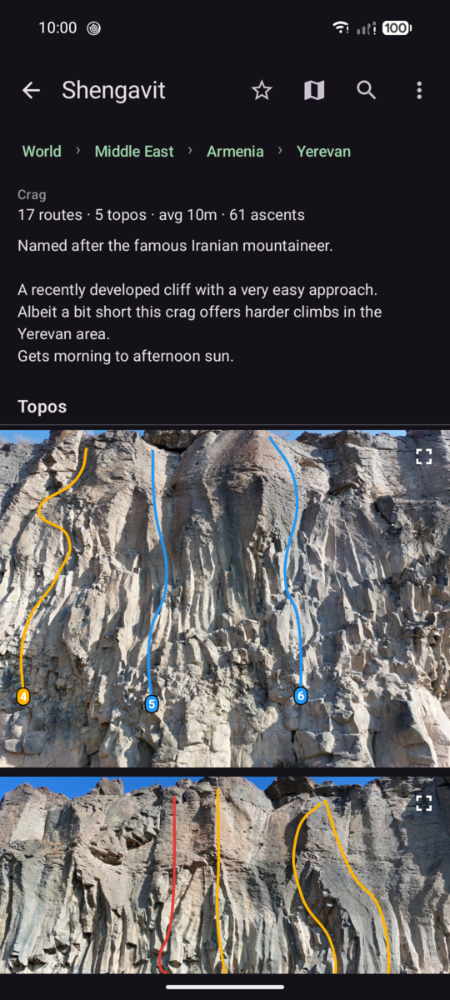
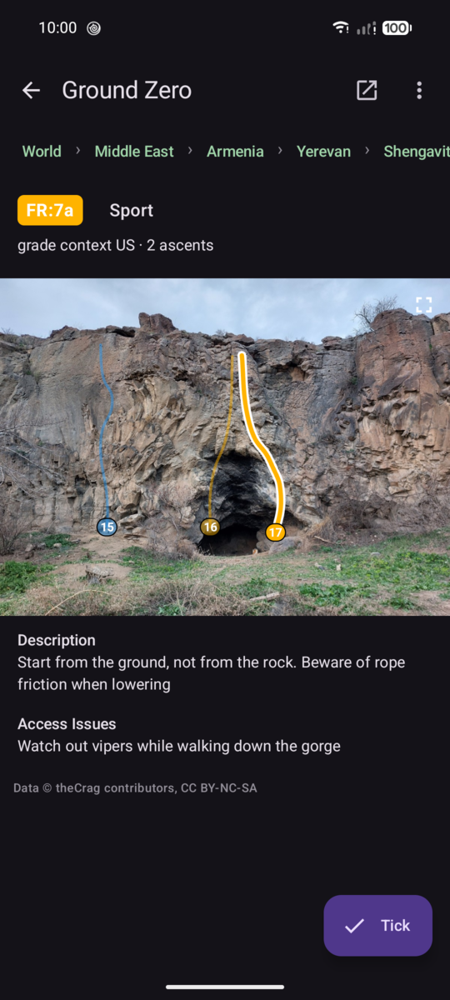
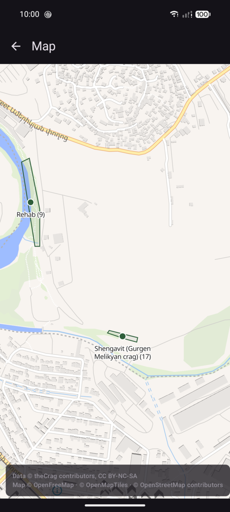
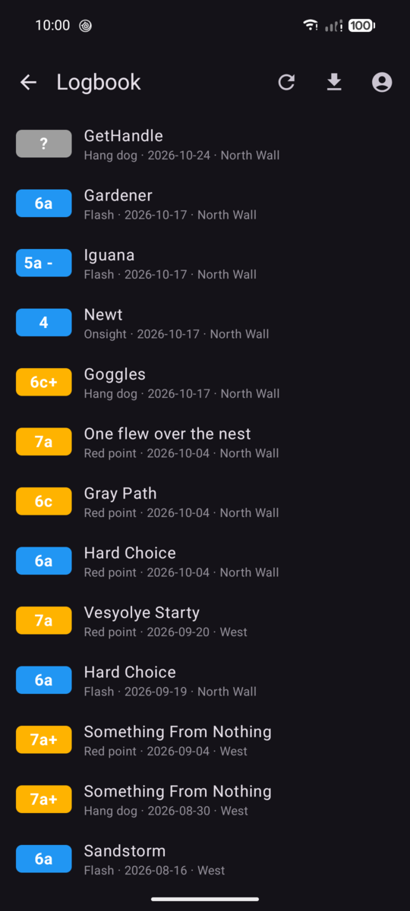
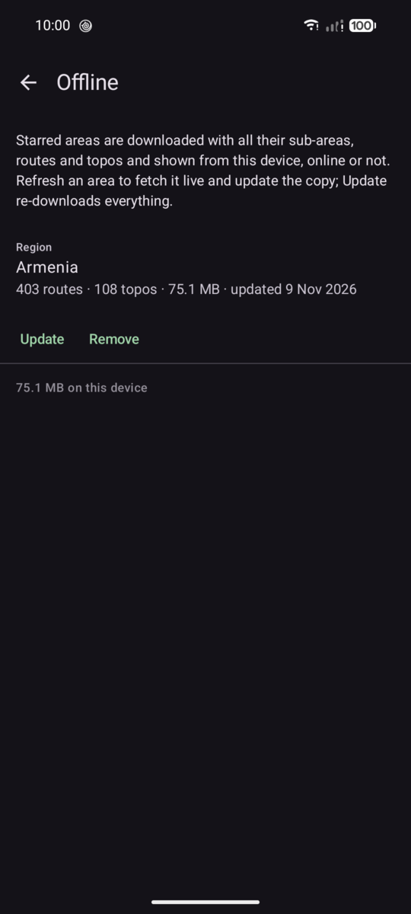

# thecrag-android

Unofficial Android client for [theCrag](https://www.thecrag.com): browse areas and crags,
list routes, view topos with the route lines drawn on, see crags on a map, keep a logbook and
tick ascents, and star crags to keep them on the phone for offline use. Everything comes from
the JSON endpoints the website itself uses; nothing is scraped from HTML.

Not affiliated with theCrag. The data is theirs and their contributors'
([CC BY-NC-SA](https://www.thecrag.com/en/article/mixedcopyright)).

> **Use at your own risk.** This app is not endorsed by theCrag and may not comply with
> [theCrag's terms of use](https://www.thecrag.com/terms) and
> [API terms](https://www.thecrag.com/en/article/api): it reads the website's internal JSON
> endpoints, which the API article reserves for the site itself, logs you in through the
> website's login form (and, since November 2026, browses with that login because theCrag no
> longer answers anonymous sessions), and keeps starred crags on the phone, which the API terms say must be
> negotiated. theCrag could rate-limit or block the addresses or accounts it sees doing this, or
> change the endpoints and break the app at any time. The app is provided as is, without
> warranty of any kind; the authors take no responsibility for anything that happens to your
> account or your data. If that is not acceptable to you, use the website.

The app sends requests only to `thecrag.com` and `image.thecrag.com` (and to
[OpenFreeMap](https://openfreemap.org/) for the map tiles). It stores your login cookie on the
phone and never your password. Nothing is collected or sent anywhere else.

## What it does

- **Browse** the world tree down to the crag, with route lists, grades, stars, route details and
  the guide text theCrag's contributors wrote. Search within any area.
- **Topos** with the routes drawn on the photo; tap a route line to open it; pinch to zoom.
- **Map** of located crags, from the world down to the sector.
- **Logbook**: log in with your theCrag account, see your ascents, tick routes (also offline;
  ticks are sent when the network is back), export the logbook as CSV. On a crag page you can
  switch the route list between *All* and *Unclimbed*.
- **Offline**: star a crag and it is downloaded with its routes and topos, then served from the
  phone without network. Everything you opened stays cached as well.
- Needs a theCrag account: since November 2026 the website answers its browsing endpoints only
  for logged-in sessions. Without logging in, only search and the map overview work.

Out of scope: adding or editing routes, crags and topos. Use the website for that.

## Screenshots

<p>



</p>
<p>



</p>

## Install

Grab the latest APK from the [Releases](../../releases) page, or add this repository to
[Obtainium](https://github.com/ImranR98/Obtainium) to get updates. Android 8.0 or newer.

## Build

The only requirement is [Nix](https://nixos.org). All recipes run inside the project's `nix-shell`,
which provides JDK 17, Gradle, the Android SDK 35, `adb`, `gh` and `just` itself.

```sh
nix-shell
> just           # list all recipes
> just build     # → app/build/outputs/apk/debug/app-debug.apk
> just test      # unit tests: API parsing, session/cache/offline interceptors, topo mapping, logbook, CSV
> just check     # lint + unit tests
> just run       # build, adb install and launch on the USB-connected phone
```

For a one-off from outside the shell, `nix-shell --run 'just check'` does the same.

The dev build installs side by side with any release build as **theCrag Dev** (`xyz.intiluha.thecrag.dev`).

How the app talks to theCrag is written up in `docs/research/api.md`; the design and its history in
`docs/PLAN.md`.

## Release

```sh
just release            # signed app/build/outputs/apk/release/app-release.apk
just release-install    # …and adb install it
just publish v0.1.0     # …and attach it to a new GitHub Release tagged v0.1.0
```

Releases are signed with the committed PKCS12 keystore `release.p12` (key alias `thecrag`). Only its
password is secret: `just release` prompts for it and hands it to Gradle as `KEYSTORE_PASSWORD`, which
is read only when a release task runs, never for debug builds or tests. Set the variable yourself to
skip the prompt. Keeping the keystore in the repo keeps the signing key stable across versions, which
is what lets Obtainium update the app in place from this repository's GitHub Releases. There is no CI:
releases are built locally.

Setting up a fresh keystore (once, inside `nix-shell`):

```sh
> just keystore           # keytool prompts for a password; `just release` will ask for the same one
> git add release.p12
```

## Licence

The code is under the Beer-ware licence (see `LICENSE`). The climbing data shown in the app belongs
to theCrag and its contributors under CC BY-NC-SA.
